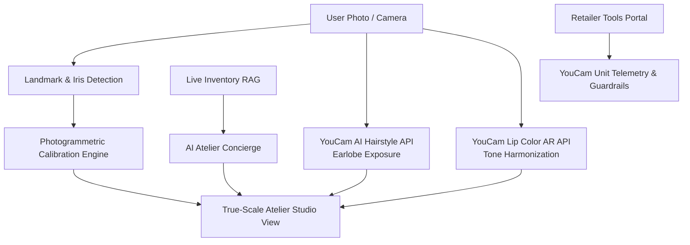

# Darpan — The Photogrammetric Virtual Atelier

> **Tagline:** The mirror that measures: true-scale fine jewellery try-on, powered to the millimeter by YouCam AI.

---

## 💡 Inspiration

Every year, luxury fine jewellery eCommerce suffers return rates exceeding **30%**. The root cause is almost never craftsmanship or material authenticity—it is **physical scale**. 

In flat 2D catalog photography, a 4 cm chandelier drop earring looks identical whether a customer has a petite or prominent earlobe. Necklaces appear static against mannequin busts, rings lack knuckle context, and shoppers cannot judge how an 18-karat yellow gold piece will reflect against their specific skin undertones.

Traditional Augmented Reality attempted to solve this with floating 3D CAD models, but failed due to two fundamental real-world barriers:
1. **The Ear Occlusion Barrier:** In everyday portraits, hair covers the ears. Shoppers cannot preview drop earrings without tying their hair back.
2. **The Sizing Paradox:** Without a physical metric reference in uncalibrated camera feeds, virtual jewellery floats without true anatomical scale.

We built **Darpan** (*the Sanskrit and Hindi word for "Mirror"*) to solve this once and for all: bridging digital convenience with high-jewellery atelier confidence through **Perfect Corp's YouCam AI API** and photogrammetric computer vision.

---

## 👁️ What It Does

Darpan is a luxury virtual try-on atelier and enterprise retail platform:

- **True-to-Scale Photogrammetric Sizing:** Eliminates guesswork by calibrating pixel dimensions against human biological benchmarks:
  - **Earrings:** Calibrated against the human corneal limbus (iris diameter), biologically consistent at $11.7\text{ mm}$.
  - **Necklaces:** Modeled with physical catenary curves ($\cosh$) to simulate true chain drape ($40\text{–}50\text{ cm}$) resting above the clavicle.
  - **Watches & Rings:** Biometric caliper gauges anchoring timepieces to an anatomical $60\text{ mm}$ wrist baseline and rings to knuckle width.
- **YouCam AI Earlobe Exposure:** Integrates YouCam's **AI Hairstyle API** to dynamically simulate updos, braids, and sleek buns, pulling hair away from the ears so earrings can be rendered cleanly on real anatomy.
- **Tone Harmonization via YouCam AR:** Uses YouCam's **Lip Color and Finish API** to analyze facial undertones (CIELAB hue angle) and harmonize warm gold or platinum reflections with matching lip finishes.
- **Live Custom Image Upload:** Shoppers can upload uncurated portraits, wrists, or hands—the client-side engine validates resolution, checks landmark clarity, and runs real-time calibration.
- **Enterprise Retailer Tools:** Protected portal (`/admin`) allowing luxury houses to onboard CAD photography, assign millimeter dimensions, and monitor live **YouCam API unit telemetry** with automated reserve floor guardrails.
- **Atelier AI Concierge:** Real-time conversational stylist powered by Retrieval-Augmented Generation (RAG) that analyzes facial geometry and matches shoppers with live catalog inventory.

---

## 🛠️ How We Built It

Darpan was built with a modern, high-performance stack emphasizing quiet luxury aesthetics, mathematical rigor, and deterministic computer vision.

### 1. Photogrammetric Scale Mathematics (LaTeX)

#### A. Iris-Calibrated Scale Engine
The average adult human iris diameter is anatomically constant at $D_{\text{iris}} = 11.7\text{ mm}$ across diverse demographics. By detecting corneal limbus boundary landmarks, we compute the real-world scale factor $S$:

$$S = \frac{D_{\text{iris}}}{d_{\text{pixels}}} \quad \left[\frac{\text{mm}}{\text{pixel}}\right]$$

For an earring with published physical drop length $L_{\text{product}}\text{ (in mm)}$, the exact render height in screen pixels $H_{\text{render}}$ is strictly determined:

$$H_{\text{render}} = \frac{L_{\text{product}}}{S} = L_{\text{product}} \cdot \left(\frac{d_{\text{pixels}}}{11.7}\right)$$

This guarantees that a $3\text{ cm}$ teardrop earring appears exactly half the physical length of a $6\text{ cm}$ chandelier on the user's specific screen.

#### B. Hyperbolic Catenary Drape Curves
Necklaces cannot be rendered as rigid ellipses. A flexible chain suspended between two anatomical collarbone anchor points at $(\pm \frac{w}{2}, y_0)$ forms a catenary curve governed by:

$$y(x) = a \cdot \cosh\left(\frac{x}{a}\right) - a$$

Where the parameter $a$ represents the ratio of horizontal tension to weight per unit length, calculated numerically from the published chain length $L_{\text{chain}}$:

$$L_{\text{chain}} = 2a \cdot \sinh\left(\frac{w}{2a}\right)$$

#### C. Undertone Harmonization ($\Delta E_{00}$)
To harmonize 18k yellow gold ($L^* = 84, a^* = 6, b^* = 38$) and platinum finishes with skin undertones, we compute CIELAB color distances using the CIE2000 metric:

$$\Delta E_{00} = \sqrt{\left(\frac{\Delta L'}{k_L S_L}\right)^2 + \left(\frac{\Delta C'}{k_C S_C}\right)^2 + \left(\frac{\Delta H'}{k_H S_H}\right)^2 + R_T \left(\frac{\Delta C'}{k_C S_C}\right)\left(\frac{\Delta H'}{k_H S_H}\right)}$$

### 2. Software Architecture
- **Framework:** Next.js 14 App Router, React 18, TypeScript.
- **Styling System:** Handcrafted Vanilla CSS design tokens (`--ink`, `--paper`, `--gold`, `--line`) providing an editorial, high-fashion aesthetic without generic UI libraries.
- **YouCam API Integration:** Enterprise REST integration with Perfect Corp's endpoints for AI Hairstyle simulation, Lip Color AR, and landmark extraction.
- **Quality Assurance:** 60 test suites with **907 passing automated tests** in Vitest covering photogrammetric calculations, error recovery states, and cart mutex synchronization.

---

## ⚡ Challenges We Faced

1. **The Ear Earlobe Occlusion Dilemma:**  
   Most shoppers upload everyday selfies where hair covers the earlobes, preventing realistic earring compositing. Instead of forcing users to take awkward photos, we integrated **YouCam's AI Hairstyle API** to synthetically style hair into sleek updos or high buns. This dynamic pre-processing clears the earlobe cleanly without altering facial features.

2. **Deterministic Scale vs. Generative Hallucination:**  
   Generic diffusion models (like Midjourney or Stable Diffusion) frequently hallucinate fake jewellery designs, alter stone facets, or warp human faces. In luxury eCommerce, product representations must be 100% faithful to the physical SKU. We solved this by using **specialized computer vision rather than generative diffusion**, maintaining exact gemstone geometry while applying deterministic photogrammetry.

3. **API Budget Telemetry & Reserve Floor:**  
   During high-traffic shopping spikes, automated AR API calls can exhaust enterprise quotas. We engineered an automated **unit reserve floor** (`UNIT_RESERVE_FLOOR = 450`) with real-time balance tracking in the Retailer Tools dashboard, ensuring uninterrupted service for checkout-ready visitors.

---

## 📚 What We Learned

- **Specialized Biometrics Win in Luxury Commerce:** Generic foundation LLMs excel at text, but precision retail requires domain-specific computer vision. Perfect Corp's YouCam API delivers the sub-millimeter biological landmark accuracy and sub-second deterministic speed required for fine jewellery.
- **Quiet Luxury in Software Design:** High-value customers and jewellery maisons reject "AI slop"—pulsing neon buttons, emojis, and cluttered badges. A minimalist editorial interface with refined typography and smooth micro-interactions creates the trust required to purchase four-figure fine jewellery online.

---

## 🚀 What's Next for Darpan

- **Real-Time 60 FPS Video Stream Try-On:** Expanding from high-resolution portrait photogrammetry to continuous live camera feed try-on with real-time head motion tracking.
- **In-Store Smart Boutique Mirrors:** Deploying Darpan to interactive 4K mirrors inside luxury physical boutiques, enabling shoppers to try on vaulted pieces not currently in showroom stock via QR code.
- **Physically-Based Ambient Caustics:** Simulating environmental lighting reflections on diamond facets and gold specular highlights according to the user's ambient room lighting.
